# BÁO CÁO BÀI TẬP 5.5: HỆ THỐNG QUẢN LÝ QUY TRÌNH XUẤT - NHẬP KHO NGUYÊN VẬT LIỆU (INVENTORY MANAGEMENT)

## MỤC 1: THÔNG TIN SINH VIÊN
- **Họ và tên sinh viên:** Nguyễn Vũ Nhật Minh
- **Mã sinh viên:** 24810320314
- **Tên Đề tài / Bài tập:** Tổng hợp Bài tập Thực hành (Bài 5.3, Bài 5.4, Bài 5.5)
---

## MỤC 2: HƯỚNG DẪN CÀI ĐẶT & CHẠY DỰ ÁN
1. Mở **SQL Server Object Explorer** trong Visual Studio (hoặc SSMS), chạy các script khởi tạo CSDL trong thư mục `Database/`:
   - `CafePOSDB` (cho Bài 5.3)
   - `HotelDB` (cho Bài 5.4)
   - `InventoryDB` / CSDL Bài 5.5 (cho Bài 5.5)
2. Mở file solution `BAI5_P2.sln` bằng **Visual Studio 2022**.
3. Kiểm tra file DAL/DatabaseHelper trong từng project, cập nhật chuỗi kết nối `connString` cho phù hợp với máy cá nhân nếu cần:
   `Server=(localdb)\MSSQLLocalDB;Database=<TenCSDL>;Trusted_Connection=True;`
4. Nhấn **Ctrl + Shift + B** để Build toàn bộ Solution.
5. Click chuột phải vào dự án muốn chạy (ví dụ `BaiTap5_3`, `BaiTap5_4`, `BaiTap5_5`) $\rightarrow$ Chọn **Set as Startup Project** và nhấn **F5** để bắt đầu.

---

## MỤC 3: HÌNH ẢNH KẾT QUẢ CÁC MÀN HÌNH CHỨC NĂNG

### BÀI 5.3: HỆ THỐNG QUẢN LÝ QUÁN CAFE (POS CAFE SYSTEM)

#### 1. Màn hình sơ đồ bàn ban đầu
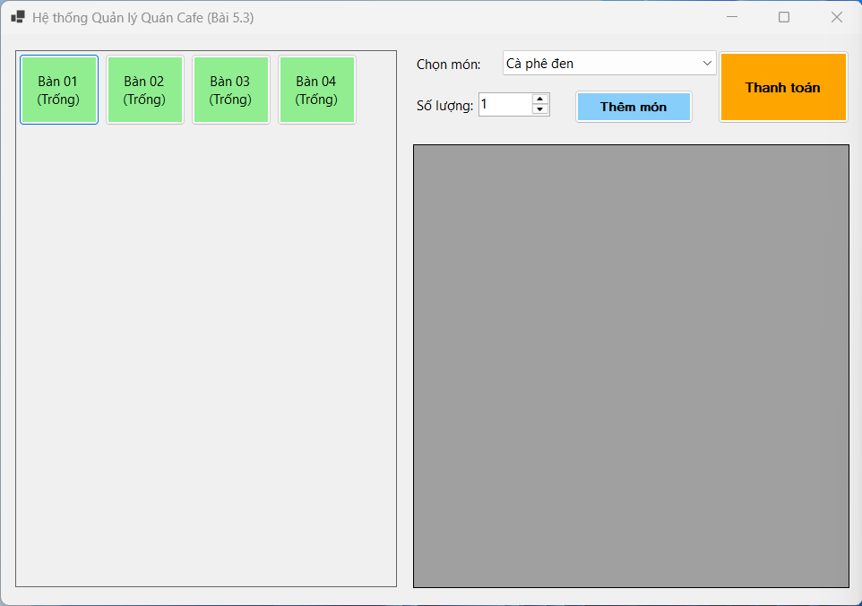

#### 2. Gọi món & Cập nhật trạng thái bàn
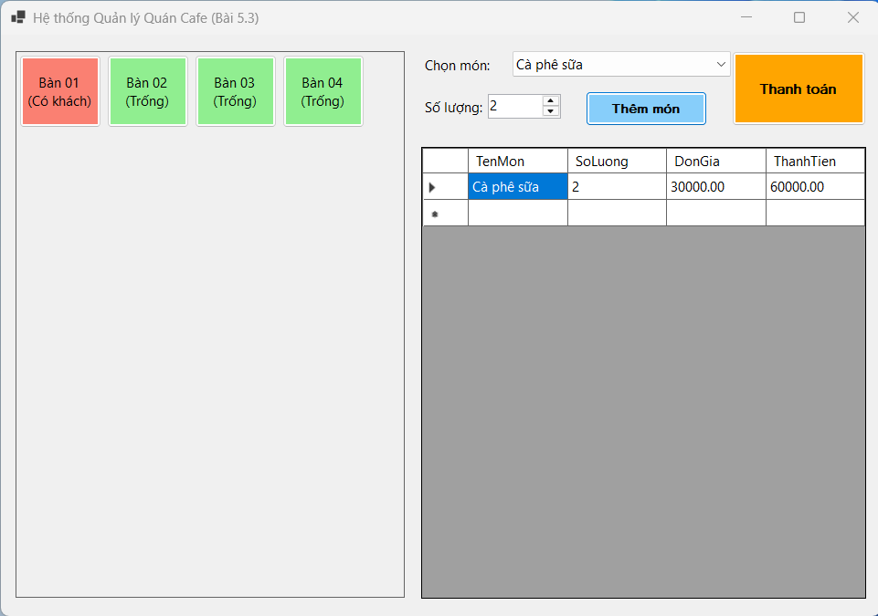

#### 3. Thanh toán hóa đơn
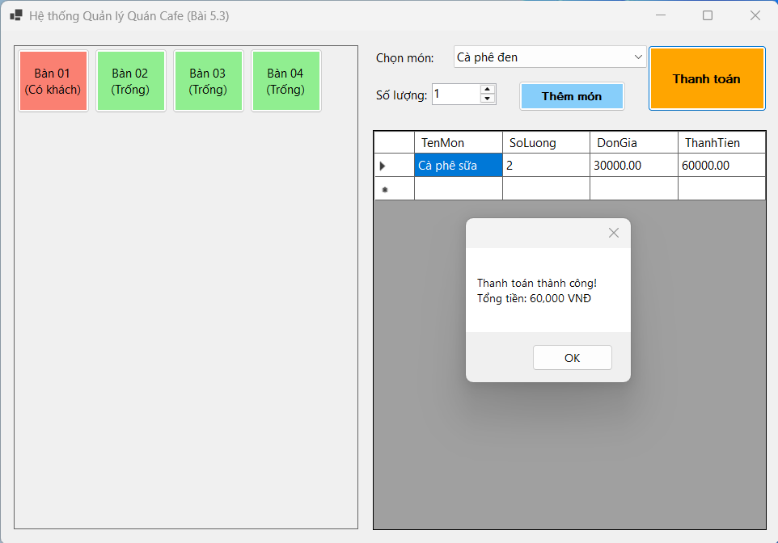

#### 4. Bắt lỗi Validation
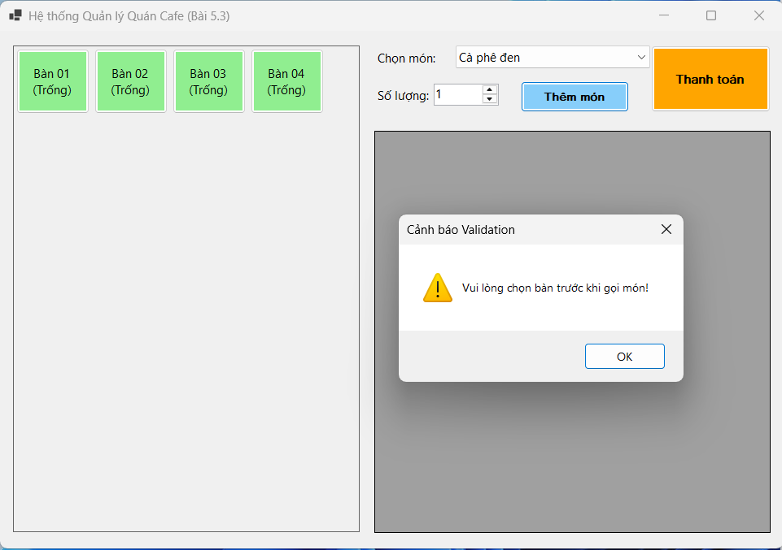

---

### BÀI 5.4: HỆ THỐNG QUẢN LÝ KHÁCH SẠN (HOTEL MANAGEMENT SYSTEM)

#### 1. Màn hình giao diện chính
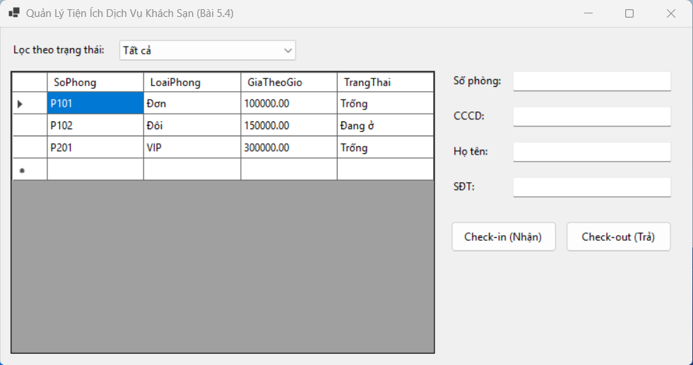

#### 2. Lọc phòng & Xử lý ngắt kết nối
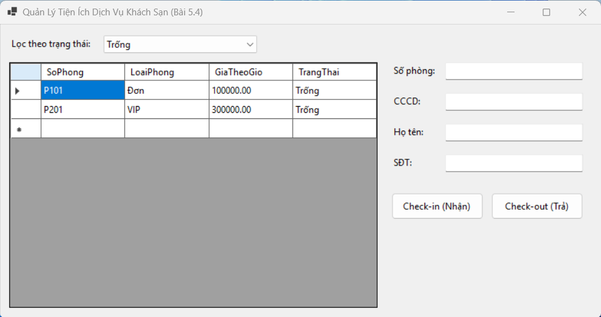

#### 3. Check-in phòng thành công
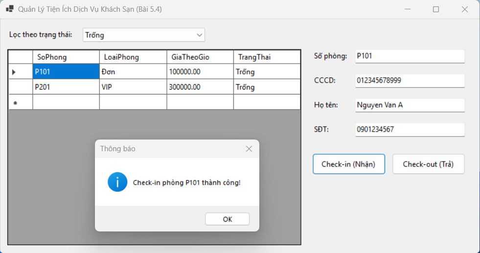

#### 4. Check-out và xuất hóa đơn
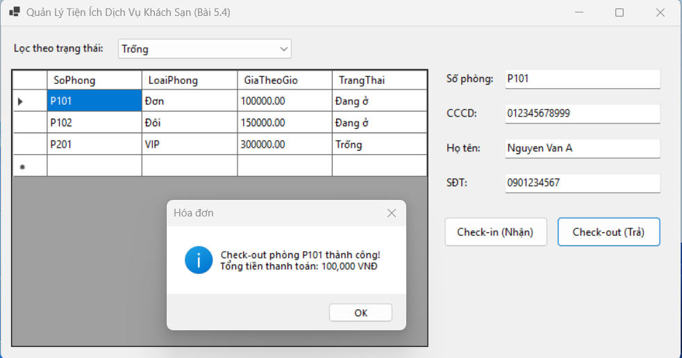

#### 5. Trạng thái phòng sau Check-out
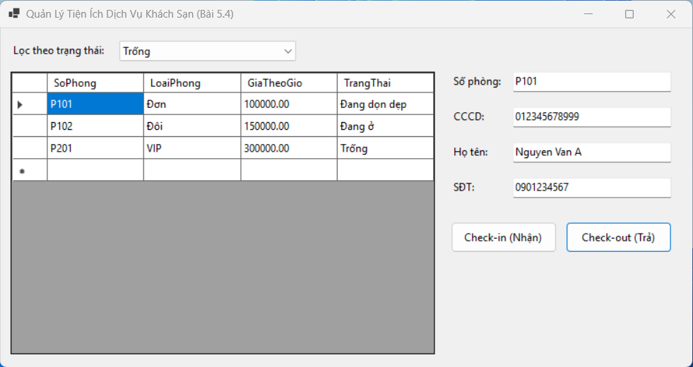

---

### BÀI 5.5: HỆ THỐNG QUẢN LÝ KHO / BÁN HÀNG (INVENTORY MANAGEMENT SYSTEM)

#### 1. Màn hình giao diện chính
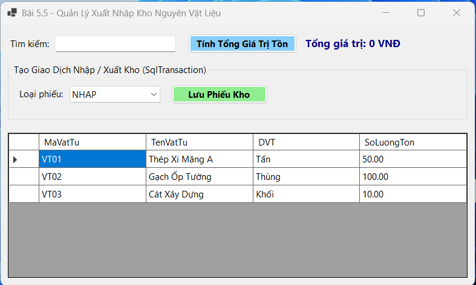

#### 2. Tìm kiếm sử dụng SqlParameter
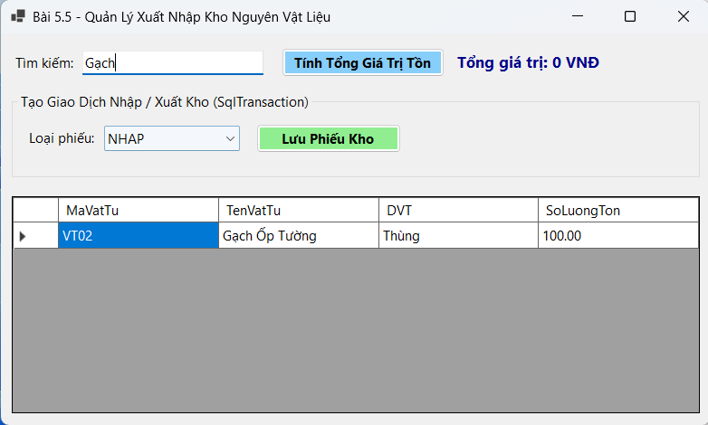

#### 3. Lập phiếu xuất/nhập thành công
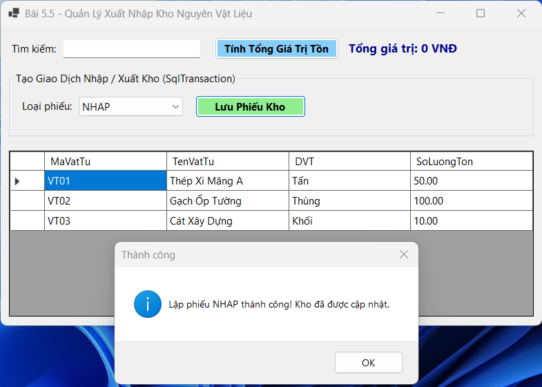

#### 4. Thống kê tổng giá trị tồn kho
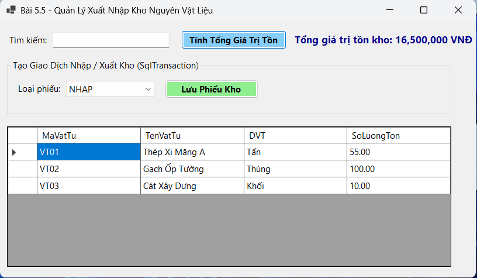

#### 5. Cảnh báo lỗi & Rollback
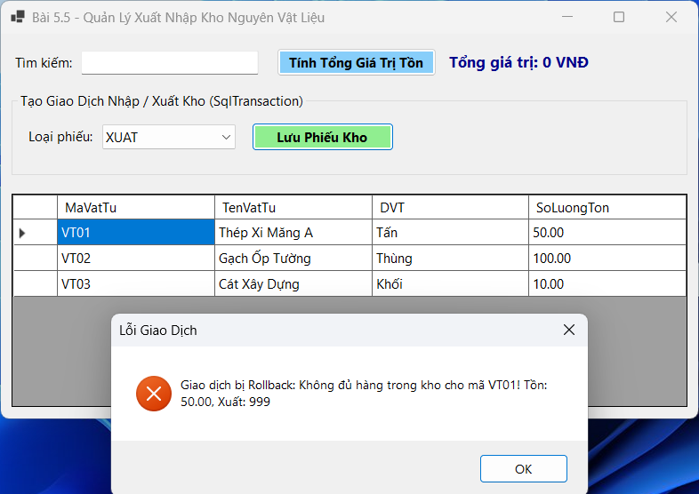
